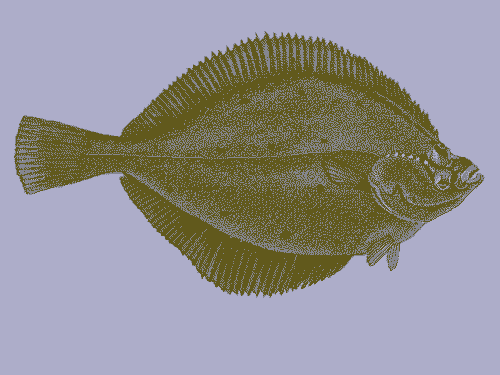

# Platessa

Platessa is a fast, lightweight Markdown viewer written in C using SDL2.

## Features
- Single portable binary, no runtime dependencies
- Drag and drop
- Images render directly in the document
- LaTeX formulas rendering via `latex` and `dvipng`
- Markdown tables support
- Vim keybindings
- Zoom with automatic window resizing

## Build Instructions
- You need the SDL2 development libraries and (optionally) a LaTeX distribution 
  for math rendering.
To build just run `make`

## Usage
- To open a file run `./platessa <file.md>` or `./platessa` and then use drag 
  and drop
- Vim keybindings: `j`, `k`, `gg`, `G`, `Ctrl-d`, `Ctrl-u`, `Ctrl-f`, `Ctrl-b`
- Zoom: `+`, `-`, `0` 
- Reload file: `r`
- Quit reader: `q`
